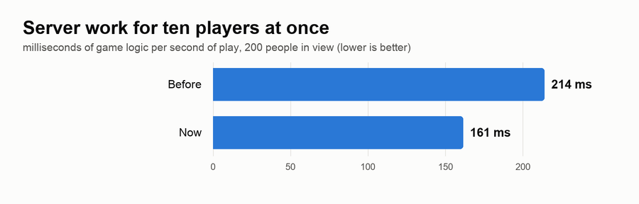
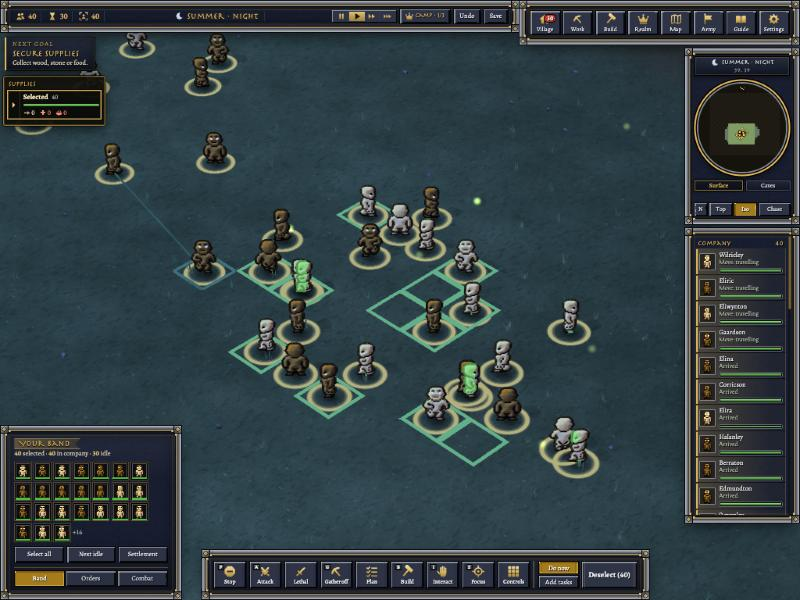
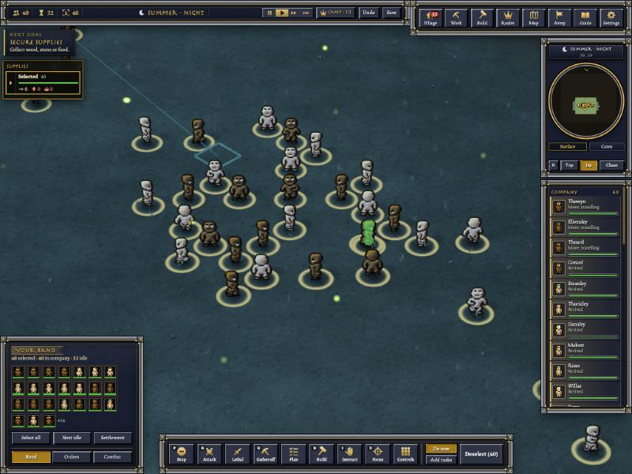
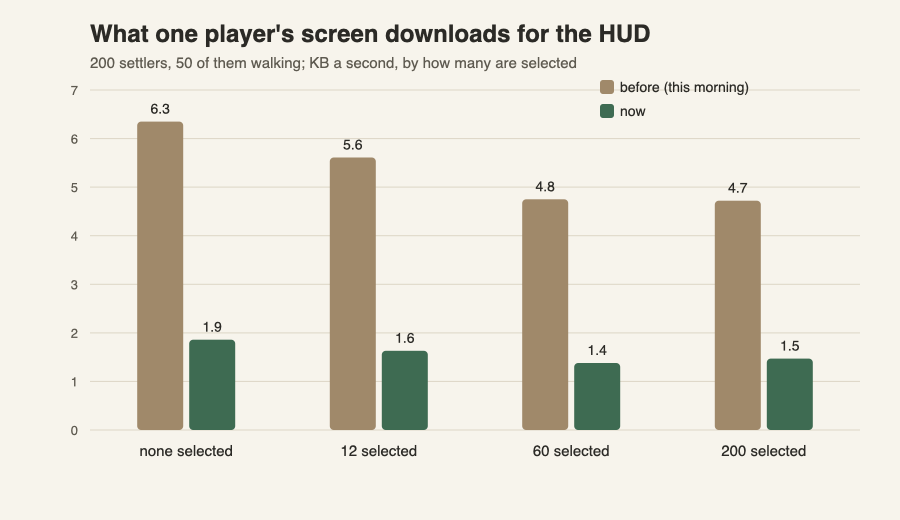

# Server upgrades, 10-31 (just after midnight)

## Room for more friends on one world

Ten players joined one world from their browsers, all looking at the same crowd of 200 people. Every tenth of a second,
for every player, the server went through everyone in view to check whether they had moved. Nearly all of them were
standing still.

Now the game engine itself keeps track of who actually changed, and the server only looks at those. People who wander
in and out of sight in the fog are still caught the moment they do. The server also used to ask "are we allies or
at war?" once for every soldier on screen. Now it asks once per player.

With ten players watching the same armies, the server now spends about a quarter less of each second on them. That is
room for more people on the same world.

Question for you: when you hosted a world back in the day, how many friends did you get on it at once?

## A little later: the server stops counting empty ground

Twice a second, for every player, the server made a list of everything in view. To find the few hundred people,
tools and trees, it first went over all 2,601 patches of ground on screen, one by one. Now the engine hands it just
the things standing there, in the same order as before. It also gets the little labels it uses to tell whether
anyone's picture changed in one go, instead of building them up word by word.

Same picture on your screen, less work behind it. The ground-counting part alone got about three times cheaper.

Question for you: what's the biggest crowd you remember seeing on one screen back then?

## Before 1 a.m.: a slow connection doesn't drown

If a friend playing in their browser has a slow connection, or their laptop stalls for a moment, the server used to keep
piling up every picture update for them, waiting until they caught up. In testing, half a minute of not keeping up
built a pile of nearly 1.5 MB and growing. Now the server notices they're behind and simply waits, sending only what
has changed once they're back. The pile stayed at a tenth of that, and when they caught up every unit was exactly
where it should be.

It's a small thing you'd never see on a good connection. It means a world hosted over the internet stays kind to
whoever has the worst Wi-Fi.

The last check of the night, in a browser: forty settlers wandering about, select all, click a spot, and off they go
in their squares.

Question for you: who was the friend with the laggy connection back in your BYOND days?

## Past 1 a.m.: one step, one message

When one of your people took a step, the server told your browser twice: once in the short "who moved where" note,
and again by resending that person's whole description in the picture of the scene. With fifty people walking about,
most of what your browser downloaded was those repeats. Now a step goes once. In a busy test village the download fell
by about a third (from 53-60 to 35-41 KB a second), with everyone still exactly where they should be.

Question for you: if you had a server full of friends tonight, what would you build together first?

## 2 a.m.: smaller messages to your friends' browsers

Everything the server tells a friend's browser now travels squeezed, the way a zip file is. Joining a world used
to pour in about 29 KB a second for the first few seconds; now it's under 5. A quiet village needs almost nothing
at all. Browsers that can't do it simply get the old way.

Question for you: what was the slowest connection you ever played a BYOND game on?

## 8 a.m.: a lighter HUD

You picked "trim the HUD updates" this morning. The panel round your screen (your company, health bars, who's
selected) used to send everyone's position and health again whenever anyone moved. Now it only sends the people who
actually changed. With 200 settlers and 50 of them walking about, your screen downloads about a third of what it did
for the HUD. The server spends roughly half as long putting those updates together, because the heaviest part now runs
inside the game's engine instead of the game's scripting. Everything on screen is exactly the same: we checked each
update against the old way, field by field.

Question for you: how many units did you have selected at once in your biggest BYOND battle?

## 9 a.m.: doing things once

You said it plainly: the server keeps rebuilding things it already built. You were right. For every person in your
company, twice a second, it re-checked their whole card to see whether anything had changed, and almost always nothing
had. Now each card remembers what it was made from, and the server only looks again when one of those things actually
moves. We checked tens of thousands of cards kept this way against freshly built ones, and every one matched. People
standing still now cost the server almost nothing; next up are the ones walking about.

Question for you: when you led a big BYOND army, how many of them were just standing around waiting for orders?

## 11 a.m.: people on the move

Last time, people standing still stopped costing the server anything. People walking still did: every step made the
server look at their card again, as if something had changed. We found the real reason. The game's engine was
counting each step twice, once as a step and once as "something about this person changed". Now a step is just a
step. With 200 settlers and 50 walking about, the server rebuilds none of their cards any more, where it used to
rebuild about fifty a second. With 2,000 people and twenty new orders every second, it rebuilds about half as many as
before, and those are real changes: someone setting off, arriving, or doing something new. As before, we checked every
kept card against a freshly built one.

Question for you: in your old BYOND games, what was the biggest crowd you ever moved across the map at once?

## 11 a.m.: the rest of the list

Once the HUD was trimmed, we looked at everything else the server does for one big village: 2,000 people, twenty new
orders a second. Four jobs stood out, and all four were doing the same thing over and over for nothing. Every second
the server re-read every person's thirty-odd skills to see if any had gone up. Twice a second it went through every
backpack looking for magic gear almost nobody carries. Every couple of seconds, each of your far-off people looked all
around them for animals, even with none in sight. And everyone who moved re-coloured their whole patch of the explored
map, though nearly all of it was coloured in already. Now each one only works when something actually changed, and the
map colouring happens inside the engine. Those four used to take about a tenth of the server's time for that village;
now they take less than a fiftieth. We tested it with deer wandering among the villagers, rune stones going in and out of packs,
and people learning skills, and every shortcut matched what the long way would have done.

Question for you: in your old BYOND kingdoms, what was the one thing you always had too many of?

## Noon: only who moved

Two more of the server's chores went through everyone in your village every second: drawing each person's circle of
sight for the fog, and placing your far-off people on the distant view. Now the game's engine keeps track of who
actually changed since it last looked, and only those people are redrawn. In a village of 2,000 with twenty new
orders a second, those two chores went from about a fiftieth of the server's time to under a hundredth, and that held
even while the computer was busy with other work. As always, every shortcut was checked against the long way, and
they matched.

Question for you: when you watched your BYOND town from far away, what did you look for first?

## 12 p.m.: the village list and the little map

The panel's village list and the little map in the corner used to be made from scratch every two seconds for a big
company. Now they only change where someone actually moved, joined or left. We also fixed something we made worse
this morning: with a hundred players near each other, the far view was checking every stranger in sight one by one.
Now it checks whichever side is smaller.

Question for you: how many other players did you usually see on screen at once in a busy BYOND game?

## 1:40 p.m.: only redraw what you can see change

With a hundred players on one server, the 3D view was redrawing about five hundred people a second, and almost all of
those redraws came out exactly the same as before. Any change to a person counted, even ones you can't see in the
world: the words under their name on the unit card, their list of orders, how cold they are. Now the 3D view only redraws
someone when something you can actually see on them changed: their health, what they're doing, what they're holding.
Redraws dropped to about a third, and the 3D view's share of the server's work fell by more than a quarter. We checked
over a hundred thousand of the skipped redraws against a fresh one, and every one matched.

Question for you: in your old BYOND games, what did you watch more, the map or the side panel?

## 2:50 p.m.: fights that look right

Two things went wrong in fights with several of your people on one enemy. Sometimes a death played over and over, or
someone's body was left standing: when an enemy died, the very next creature to appear quietly took over its place in
the 3D view, death and all. And a fighter could end up drawn a step or two away from the circle under its feet, left
behind where its last swing ended while it moved on. Now each creature keeps its own place in the view, and a fighter's
figure stays on its circle through every swing and stagger. We watched dozens of staged fights to be sure.

Question for you: in a BYOND fight, what did you watch, your own fighters or the enemy going down?

## 3 p.m.: the village panel stops rewriting what it already wrote

Every time one of your people's status changed ("Chopping", "Walking to the store"), the server wrote out their whole
entry for the village panel again: their name, their picture, their pack, everything. Nine times out of ten almost all of
it was exactly what it had written a moment before. Now it keeps what it wrote and only writes the line that changed. The
panel looks the same as ever; the server just spends less time on it. We checked several million of those reused lines
against a fresh one, and every one matched.

Question for you: what did you keep open on your screen the most in BYOND, the map or your stats?

## 6 p.m.: a 20-year-old sweep

We went looking for why the 3D view still redrew some of your people for no reason, and found a sweep from the original
2006 game. Once a minute it went through every creature in the world and wiped the little "dodge", "miss" and "block"
marks off them, whether they had one or not, and each wipe counted as a change. Now wiping a mark that isn't there
changes nothing. We also stopped the server re-working out how hurt everyone was each time they took a step, since a
step never changes that. Unneeded redraws in a busy world fell from over a hundred a second to about ten. As always,
everything we now skip was checked against doing it the long way, and it all matched.

Question for you: what's the oldest piece of a game you've played that you'd never want changed?
