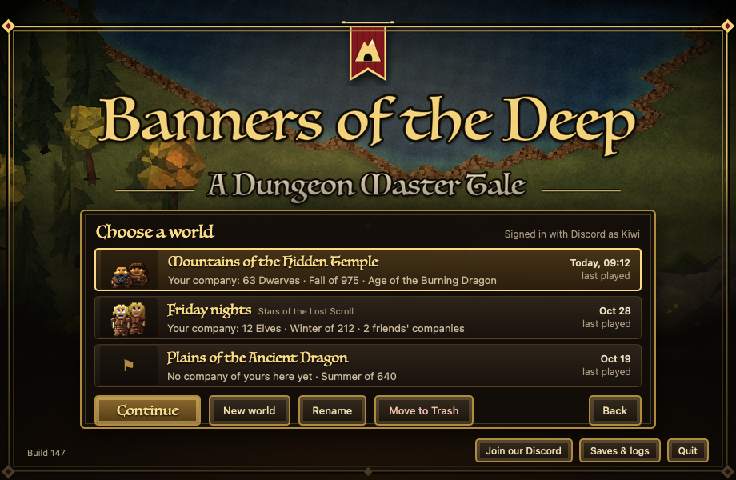
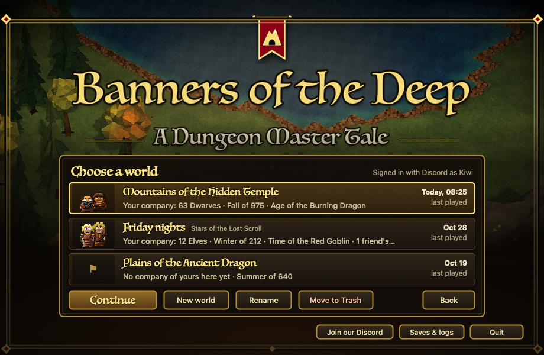
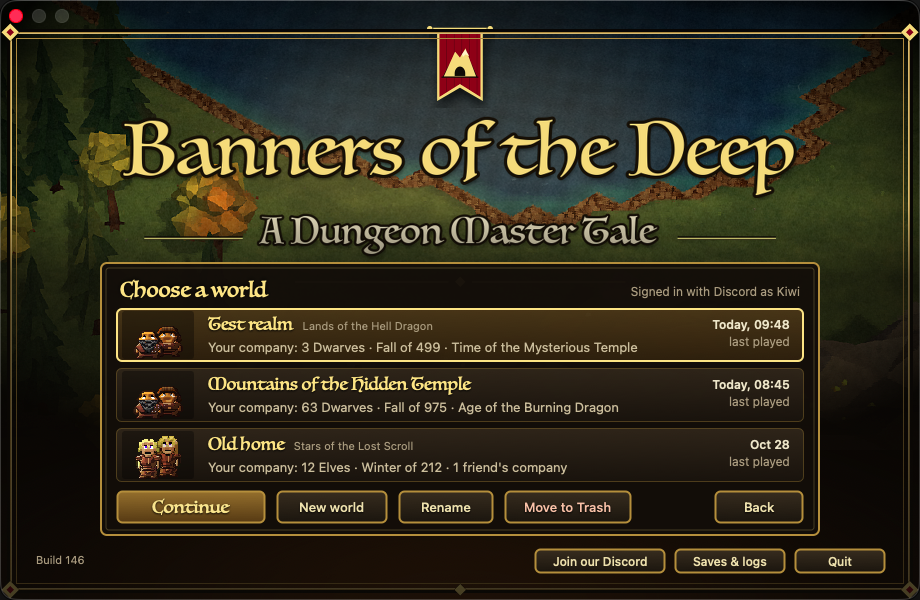

# Choosing a world, 10-31 (a plan, not built yet)

## Several worlds side by side

Back in the BYOND days a world was whatever server you could find that night. When it went down, your dwarves went
with it. Today the game keeps one world on your Mac, and "start over" means leaving your old people behind in it.

The plan is a world list behind Play. Your last world is at the top, ready to continue. Next to it are any others
you've started: a quiet one for building, one you open to friends on Friday nights. Each world keeps its own people,
its own history and its own name. Your settings, your achievements and the designs you've saved come with you into
every one.

Deleting a world puts it in the Trash, so you can still change your mind. Hosting for friends asks which world to
open. Later, the same list becomes the list of servers when the big shared world arrives.

## Later that morning: it's built

The owner said yes to the plan, so the list is built. This is the real launcher window, with three made-up worlds:

Your current world shows up first, with its saves exactly where they were. A new world starts on the same land with
its own name and history. One more change while we were in there: a nasty word from the 2006 land-name lists can no
longer name a world.

And a bug from 2006 is gone: half of all lands lost the start of their name ("Stars of the", "Hell of the"...),
which got shouted into world chat instead. Now every land gets its whole name, like "Purgatory of the Lost Scroll".

## And in the real app

Tried in the real app (build 146) with real clicks and typing: Play, picking worlds, renaming one, sending one to the
Trash and putting it back, hosting, then a brand-new world. A Dwarf company started there, and when we came back the
list showed it at the top:

The world list is in build 146. The whole-names fix comes with the next build.

Question for you: back then, did you keep one world going for months, or start fresh every time a new server
popped up?
