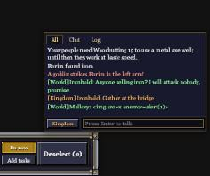
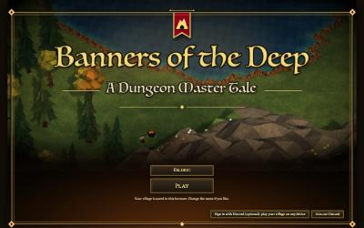
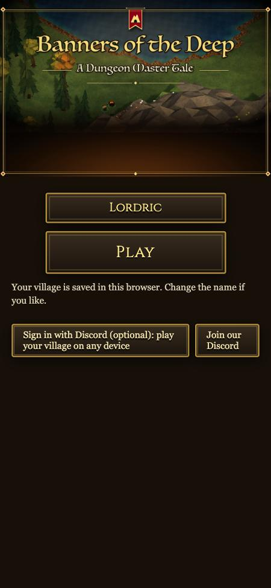

# Chat box, Play first, rare races, 11-01

Players can now talk to each other in a WoW-style chat box. The front page is now one big **Play** button: no
Discord needed, and the village is saved in the browser. One in ten new players finds a Dragon or a Spider waiting in
their race picker.

## Done

- **Chat box** (bottom right, where the tips and news used to pop up; the owner: "a world chat box where the log is
  like warcraft people can toggle between", then "we need local chat and world chat"):
  - **Tabs:** All (everything), Chat (what players say) and Log (news, tips and fights: the same history as Village ›
    Log, so there is still one log).
  - **Talking:** press Enter, type, press Enter. The button on the line switches between World, Local and Kingdom, and
    so do /w, /l (or /s) and /k at the start of a line. Escape closes it.
  - **World:** everyone online, free for now (the crafted item, spell and pigeon ideas come later), with a 3 s wait
    between one player's lines.
  - **Local:** players looking at, or with people within, 40 tiles of where you look.
  - **Kingdom:** your realm, its ruler and the realms that serve it.
  - **Fading:** left alone, it fades down to the last 20 seconds of lines, like the old corner did.
  - **Guards:** muted players can't talk. Markup is stripped, the word list and the spam guard apply, and lines are
    capped at 300 characters. Each line is filed under its channel by the game itself, so typing "[World]" can't
    fake one.
  - **Names:** a line goes under your house name. Before you have one, it uses your leader's name, never a Discord
    number.
- **Play first** (the owner: "remove the force to sign up as discord and just do guest and play and save on browser"):
  - The front page wears the Mac launcher's look (the owner: "use our full screen launcher and etc to make it look
    legit"): its painting fills the screen, with the banner and the title. Under it are the launcher's gold-edged
    plates in the game's own lettering: a name already filled in (change it if you like), and a big Play. Below:
    "Your village is saved in this browser."
  - Discord is a small optional plate in the corner ("Sign in with Discord (optional): play your village on any
    device"), next to "Join our Discord", as on the launcher. On a phone, the painting sits on top and the plates
    stack under it.
  - After Play, the race picker is the first thing you see.
- **Rare races for newcomers** (the owner: "give them a chance to get a rare race of dragon or spider", 1 in 10): one
  race picker in ten also offers a Dragon or a Spider, on top of the old small chance of any rare people.

## Numbers

| Check | Result |
| --- | --- |
| Chat box arena check (who hears World, Local, Kingdom; ignores; mutes; word list; 300 cap; World wait; names) | 20 of 20 |
| Chat box in the overlay HUD (tabs, Enter, /k, hostile text shown as plain text) | as expected |
| Rare offer for newcomers | 0 → 10% of race pickers |

