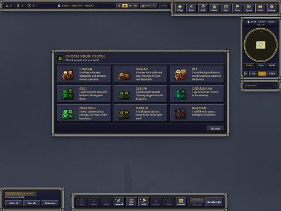
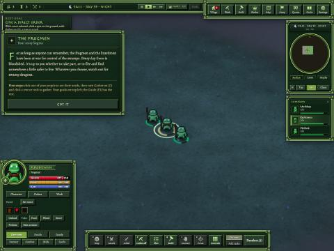

# The first minute, 11-01

Three strangers tried the game this morning, all as guests, and left after about 25, 50 and 90 seconds. Nothing broke:
no errors, and the page loaded in 10–20 seconds. Playing the start as a newcomer showed why it's slow to grab you:
four screens before you can do anything, then three people standing still with a small hint in the corner. The start
is now two screens, guests can play everything, and the server records where newcomers stop.

## Done

- **Two screens to play, not four.**
  - A new player goes straight from loading to the race picker. The "A new land lies before you" card is gone for
    them; a fallen company still gets its "Begin again" card.
  - After Begin on the company card, the game starts at once. The people's story is now a note at the side with a
    Got it button, not a second Begin in the middle of the screen. You can play while it's open.
- **Guests unlocked, for now** (the owner: "unlock all the races and unlock all the guest freezes for now"):
  - **Races and growth:** guests pick any race, rare ones included. They can join a realm and grow past 30 people.
  - **Actions:** they can declare war, claim land, trade, keep a market stall, post quests, use world chat, send
    private messages, and make allies and clans.
  - **One switch:** it all sits behind one setting, so the locks can come back at once.
- **Tips stay on screen.** In a narrow window the command bar covered half of the tip box (a newcomer's first tip read
  "...people need Woodcutting 15 to"). Tips now move up above the bar when they would overlap it.
- **Where newcomers stop.** On the public server, each player's way in is recorded step by step, with seconds since
  joining: joined, race picker, race, company, Begin, then the guide's goals (first select, order, gather, craft,
  defend), and leaving. `tools/first_minute.py` prints each visit and how many outside visitors reached each step. It
  leaves this Mac's own tests out. Only names the game gave are recorded, never anything typed and no addresses.

## Numbers

| Check | Result |
| --- | --- |
| First-minute arena check | 6 of 6 |
| Guest arena check (unlocked by default, and every lock with the switch back on) | passed |
| Bug reports, admin, restart notice and cap, unit limit, no first house | all passed again |
| Screens before play | 4 → 2 |
| Tip box when the bar overlaps it | was half hidden → now sits just above the bar |

